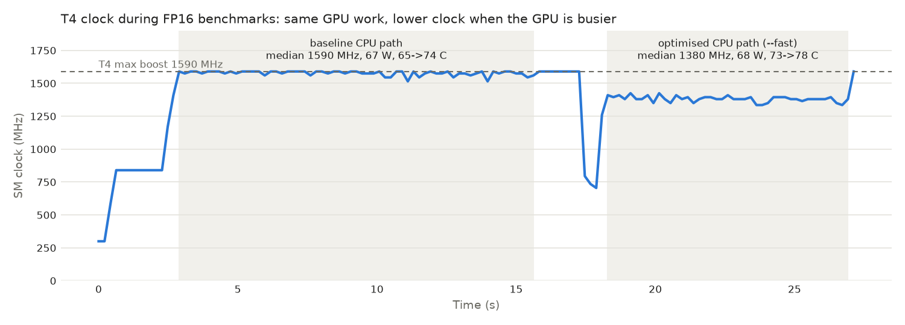

# Findings: YOLOv8s on TensorRT (C++), Kaggle T4

Every number below was measured in one Kaggle session: Tesla T4 (driver 580.178), 4-core Xeon @ 2.0 GHz,
TensorRT 10.16.1, PyTorch 2.11 (CUDA 13.0), Ultralytics 8.4.208, OpenCV 4.6 (C++). Batch 1, 640x640.
Latency = median of 3 interleaved runs of 500 timed frames (after 50 warm-up) on 300 COCO images.
mAP = COCO val2017, first 4500 images (INT8 calibrated on the other 500). Raw data: `results/`.
The full run with every output: https://www.kaggle.com/code/lalithtrs/yolo-trt-kaggle

## Headline

| Configuration | Total P50 | Total P95 | FPS | mAP50-95 | vs PyTorch FP32 |
|---|---|---|---|---|---|
| PyTorch FP32 (Ultralytics) | 14.48 ms | 18.91 ms | 69 | 44.4 | 1.0x |
| PyTorch FP16 (Ultralytics) | 10.90 ms | 12.64 ms | 92 | 44.3 | 1.3x |
| **TensorRT FP16, C++ (optimised CPU)** | **4.25 ms** | **5.21 ms** | **235** | **44.5** | **3.4x, no accuracy loss** |
| TensorRT INT8 entropy calib, C++ (optimised CPU) | 3.30 ms | 4.38 ms | 303 | 41.1 | 4.4x, -3.4 mAP |
| **TensorRT INT8 MinMax calib, C++ (optimised CPU)** | **3.30 ms** | **4.34 ms** | **303** | **42.7** | **4.4x, -1.8 mAP** |

**Recommended configuration: TensorRT FP16.** It is 3.4x faster end to end than PyTorch FP32 (3.6x at P95)
with no loss in mAP. For maximum speed, INT8 with MinMax calibration is a further 22% faster than FP16 for
-1.8 mAP (entropy calibration cost -3.4 mAP at the same speed).

## Findings

**1. The C++ pipeline is numerically correct.** TensorRT FP32 scores 44.48 mAP vs 44.39 for PyTorch FP32
(+0.10, target within 0.5). Preprocessing, box decoding, class-aware NMS and the COCO class mapping match.
The small gain is plausibly from padding to a full 640x640 square (Ultralytics `predict` pads to a multiple of 32).

**2. TensorRT cuts model inference 4.7x at FP16 and 7.7x at INT8.** GPU inference: 11.83 ms (PyTorch FP32)
-> 7.33 (TRT FP32) -> 2.28-2.50 (TRT FP16) -> 1.53-1.83 ms (TRT INT8). Even at FP32 TensorRT is 1.6x faster,
from layer fusion and kernel auto-tuning alone. FP16 is the biggest single step (about 3x over TRT FP32)
because the T4's Tensor Cores need FP16 or INT8.

**3. FP16 costs no accuracy.** TRT FP16 vs FP32: -0.02 mAP50-95, identical per object size.

**4. After TensorRT, the CPU became the bottleneck (the key finding).** In the straightforward C++ pipeline,
CPU pre- plus postprocessing took **3.64 of 6.61 ms (55%) at FP16** and **3.65 of 6.22 ms (59%) at INT8**,
more than the GPU (2.92 / 2.50 ms). Speeding up the model alone would have hit a wall: INT8's faster
inference saved only 0.39 ms end to end (6.61 -> 6.22 ms).

**5. Optimising the CPU stages gave a 1.6-1.9x end-to-end speedup with identical output.**
- Preprocessing 2.34 -> 0.78 ms (3.0x): one fused pass (letterbox, BGR->RGB, /255, HWC->CHW) written straight
  into the pinned input buffer, instead of four OpenCV passes with temporaries.
- Postprocessing 1.30 -> 0.29 ms (4.5x): class scores read row by row (contiguous, vectorised) instead of
  strided per anchor.
- Total: FP16 6.61 -> 4.25 ms (-36%), INT8 6.22 -> 3.30 ms (-47%).
- Verified: same 33,977 detections on 300 images, zero box or score difference.

**6. INT8 with entropy calibration (500 images) loses 3.4 mAP, hitting small objects hardest.**

| Object size | FP32 | INT8 | Relative loss |
|---|---|---|---|
| All (mAP50-95) | 44.5 | 41.1 | -7.7% |
| Small | 26.1 | 22.8 | -12.6% |
| Medium | 49.4 | 46.4 | -6.1% |
| Large | 59.8 | 58.5 | -2.2% |

INT8 also returned fewer confident detections (4.3 vs 6.1 per image above 0.25 confidence), so quantisation
is lowering scores. That pattern points at range clipping in the detection head, tested in finding 7.

**7. MinMax calibration halves the INT8 loss at the same speed.** Same 500 calibration images, same build
settings, only the calibrator changed:

| | FP32 | INT8 entropy | INT8 MinMax |
|---|---|---|---|
| mAP50-95 | 44.5 | 41.1 (-3.4) | **42.7 (-1.8)** |
| mAP50 | 61.0 | 56.8 | **59.0** |
| Small | 26.1 | 22.8 | **24.5** |
| Medium | 49.4 | 46.4 | **47.6** |
| Large | 59.8 | **58.5** | 58.0 |
| Confident detections / image | 6.09 | 4.32 | **5.76** |
| Total P50 (optimised CPU) | 9.99 ms | 3.30 ms | 3.30 ms |

Entropy calibration picks a clipping range that minimises information loss for typical values and cuts off
rare large activations; MinMax keeps the full observed range. MinMax restored most of the missing confident
detections (4.3 -> 5.8 per image vs 6.1 for FP32) and gained most on small objects, which supports the
clipping explanation. The cost of covering the full range is coarser resolution for ordinary values, visible
as a slightly lower large-object AP (-0.5). Speed is identical (3.30 ms, about 303 FPS).

**8. Host-device copies are now a visible cost.** H2D 0.43 ms + D2H 0.23 ms = 0.66 ms per frame: 15% of
the FP16 total and 20% of INT8. The input is copied as float32 (4.9 MB); uploading uint8 pixels (about 0.9 MB
for a 640x480 image) and preprocessing on the GPU would remove most of it.

**9. INT8 shrinks the engine 4x.** FP32 56.1 MB, FP16 23.8 MB, INT8 13.9 MB (MinMax 14.0 MB). Build time grows
with precision search and calibration: 83 s, 276 s, 766 s (MinMax 728 s).

**10. The T4 is power-limited, so GPU time depends on how busy the GPU is kept.** GPU inference was about
10% higher in the optimised-CPU runs (FP16 2.28 -> 2.50 ms) although the GPU work is identical. A clock log
during two 2000-frame FP16 runs (`results/gpu_clocks.csv`) shows why:

| Run | GPU busy share | SM clock (median) | Power (median) | Temp | Inference P50 |
|---|---|---|---|---|---|
| Baseline CPU path | 44% (2.90 of 6.60 ms) | **1590 MHz** (max boost) | 67.0 W | 65->74 C | 2.26 ms |
| Optimised CPU path | 74% (3.17 of 4.27 ms) | **1380 MHz** | 68.4 W | 73->78 C | 2.52 ms |

Both runs draw about the same power, right at the T4's 70 W limit. With the faster CPU path the GPU idles
less between frames, so to stay within 70 W the driver lowers the clock by 13% (1590 -> 1380 MHz), and
inference takes 12% longer (2.26 -> 2.52 ms), in line with the clock drop. Temperature is not the cause: at
the same 73-74 C the clock was 1575-1590 MHz in the baseline run and 1395-1410 MHz at the start of the fast
run. On a power-capped GPU, benchmarks should report the duty cycle, and end-to-end latency is the number
that matters.

## Measurement notes

- **Reproducibility.** The 2000-frame runs reproduce the 3x500-frame medians: baseline FP16 total 6.60 ms
  (vs 6.61), optimised 4.27 ms (vs 4.25). Run-to-run spread of total P50 across the 3 repeats was 0.01-0.76 ms.
- **Preprocessing tail.** The fused preprocessing has P95 = 2.2x its P50 (1.74 vs 0.78 ms) vs 1.2x before.
  Likely cause: its cost now depends on the source image size (resize), while the old path was dominated by
  fixed 640x640 passes. Not verified.
- **PyTorch comparison.** PyTorch numbers come from Ultralytics `predict` (different letterbox, GPU NMS), so
  stage-by-stage comparison with C++ is approximate; totals are the fair comparison.
- **Scope.** Single session, single GPU type (T4); each engine was built once, so build-to-build variation
  was not measured. See `REPRODUCE.md` for what to expect on other hardware.

## Future work

- **GPU preprocessing kernel** (upload uint8, letterbox + normalise in CUDA): removes the 0.78 ms CPU stage
  and most of the 0.43 ms host-to-device copy, at most about 1.1 of the 3.3 ms INT8 frame.
- **Pipelining:** overlap frame N+1's CPU preprocessing with frame N's GPU work (two streams, double
  buffers). Raises throughput (FPS) rather than single-frame latency.
- **Close the remaining INT8 gap** (-1.8 mAP with MinMax): keep the detection head in FP16 (mixed precision),
  or use explicit Q/DQ quantisation (NVIDIA ModelOpt). Goal: under 1 mAP loss at close to INT8 speed.
- **Broader coverage:** batch > 1 throughput, dynamic input shapes, a Jetson port (engines rebuilt on device).
