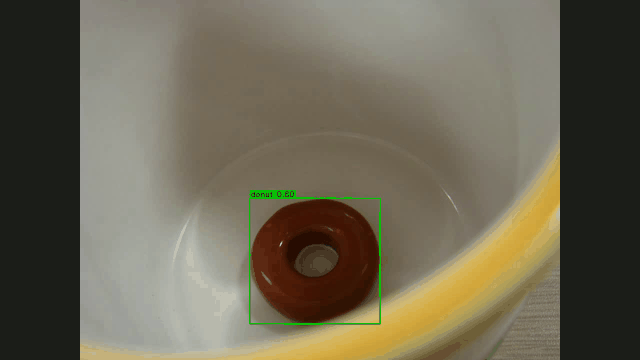
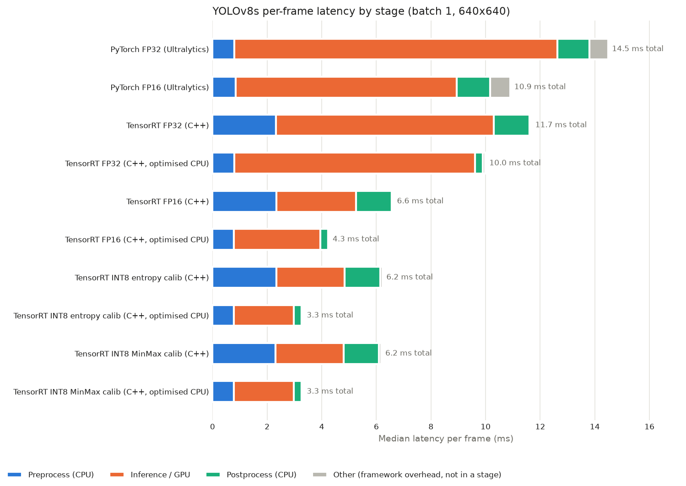

# yolo-tensorrt-cpp

A C++ TensorRT inference pipeline for YOLOv8s, benchmarked against PyTorch at FP32 / FP16 / INT8,
with per-stage latency (P50 / P95), FPS and COCO mAP, all measured on the same Kaggle T4.

**TL;DR** (measured, batch 1, 640x640, Tesla T4)

- **3.4x faster than PyTorch with no accuracy loss:** 14.48 -> 4.25 ms per frame (69 -> 235 FPS) at FP16, 44.5 mAP50-95.
- **After TensorRT the CPU was the bottleneck:** pre/post-processing took 55% of the frame. A fused, vectorised
  CPU path cut it 3.4x with identical detections.
- **INT8 is 4.4x faster (303 FPS).** Entropy calibration lost 3.4 mAP; switching to MinMax calibration
  halved the loss to 1.8 mAP (42.7) at the same speed.

Full analysis and next steps: [`FINDINGS.md`](FINDINGS.md). Reference run with every output: [public Kaggle notebook](https://www.kaggle.com/code/lalithtrs/yolo-trt-kaggle).



## Pipeline

```
yolov8s.pt ──► ONNX (1x3x640x640, opset 17) ──► TensorRT engines: FP32 / FP16 / INT8 (entropy + MinMax calibration)
                                                          │
  image ─► letterbox + RGB + /255 + CHW (CPU) ─► H2D ─► enqueueV3 ─► D2H ─► decode + class-aware NMS (CPU) ─► boxes
           └──────────── timed separately: preprocess │ GPU (CUDA events) │ postprocess ────────────┘
```

The C++ app (`src/main.cpp`) has three modes:

| Mode | What it does |
|---|---|
| `bench LIST` | per-stage latency, P50/P95, FPS, prints a JSON line |
| `coco LIST OUT.csv` | detections for COCO mAP (conf 0.001, NMS IoU 0.7, max 300) |
| `video IN OUT` | annotated demo video |

`--fast` switches the CPU stages to the optimised path (fused single-pass preprocessing, contiguous
vectorised decode); the default is the plain OpenCV baseline, so both can be measured.

## Results

<!-- RESULTS:START -->
<!-- generated by tools/update_readme.py from results/results.md; do not edit -->

Measured on **Tesla T4, 580.178.04, 15360 MiB**, CPU Intel(R) Xeon(R) CPU @ 2.00GHz (4 cores). TensorRT 10.16.1.11, PyTorch 2.11.0+cu130 (CUDA 13.0), Ultralytics 8.4.208, OpenCV (C++) 4.6.0.

All latencies are per frame at batch 1, 640x640, median of repeated runs (P50 / P95 over 500 timed frames after 50 warm-up frames). "GPU ms" for TensorRT includes the host-to-device and device-to-host copies; for PyTorch it is Ultralytics' model inference time. mAP is COCO val2017 (4500 images, not used for INT8 calibration).



| Variant | Pre ms | GPU ms | Post ms | Total P50 ms | Total P95 ms | FPS | mAP50-95 | mAP50 |
|---|---|---|---|---|---|---|---|---|
| PyTorch FP32 (Ultralytics) | 0.81 | 11.83 | 1.16 | 14.48 | 18.91 | 69.0 | 44.4 | 60.7 |
| PyTorch FP16 (Ultralytics) | 0.84 | 8.11 | 1.22 | 10.90 | 12.64 | 91.7 | 44.3 | 60.7 |
| TensorRT FP32 (C++) | 2.33 | 7.98 | 1.29 | 11.67 | 12.21 | 85.7 | 44.5 | 61.0 |
| TensorRT FP32 (C++, optimised CPU) | 0.80 | 8.81 | 0.29 | 9.99 | 11.02 | 100.1 | 44.5 | 61.0 |
| TensorRT FP16 (C++) | 2.34 | 2.92 | 1.30 | 6.61 | 7.19 | 151.3 | 44.5 | 60.9 |
| TensorRT FP16 (C++, optimised CPU) | 0.78 | 3.16 | 0.28 | 4.25 | 5.21 | 235.1 | 44.5 | 60.9 |
| TensorRT INT8 entropy calib (C++) | 2.35 | 2.50 | 1.30 | 6.22 | 6.82 | 160.8 | 41.1 | 56.8 |
| TensorRT INT8 entropy calib (C++, optimised CPU) | 0.78 | 2.19 | 0.29 | 3.30 | 4.38 | 302.7 | 41.1 | 56.8 |
| TensorRT INT8 MinMax calib (C++) | 2.31 | 2.48 | 1.29 | 6.18 | 6.88 | 161.7 | 42.7 | 59.0 |
| TensorRT INT8 MinMax calib (C++, optimised CPU) | 0.78 | 2.20 | 0.29 | 3.30 | 4.34 | 302.6 | 42.7 | 59.0 |

### TensorRT GPU stage breakdown (P50 ms, optimised CPU path)

| Precision | H2D copy | Inference | D2H copy | GPU total |
|---|---|---|---|---|
| FP32 | 0.43 | 8.14 | 0.23 | 8.81 |
| FP16 | 0.43 | 2.50 | 0.23 | 3.16 |
| INT8 | 0.43 | 1.53 | 0.23 | 2.19 |

### Correctness checks

- **PASS**: TensorRT FP32 mAP vs PyTorch FP32: +0.10 points (expected within 0.5)
- **PASS**: TensorRT FP16 vs FP32 mAP: -0.02 points (expected almost identical)
- **CHECK**: TensorRT INT8 (entropy calibration) vs FP32 mAP: -3.43 points (a drop is expected; report it as measured)
- **PASS**: TensorRT INT8 (MinMax calibration) vs FP32 mAP: -1.79 points
- **PASS**: Optimised CPU path gives the same detections as the baseline path on 300 images (33977 vs 33977 boxes, max box diff 0.000 px)

### Headline

- TensorRT FP32 (C++, optimised): 9.99 ms/frame vs PyTorch FP32 14.48 ms -> **1.4x** end-to-end
  - CPU-path optimisation at FP32: pre 2.33 -> 0.80 ms, post 1.29 -> 0.29 ms, total 11.67 -> 9.99 ms
- TensorRT FP16 (C++, optimised): 4.25 ms/frame vs PyTorch FP32 14.48 ms -> **3.4x** end-to-end
  - CPU-path optimisation at FP16: pre 2.34 -> 0.78 ms, post 1.30 -> 0.28 ms, total 6.61 -> 4.25 ms
- TensorRT INT8 (C++, optimised): 3.30 ms/frame vs PyTorch FP32 14.48 ms -> **4.4x** end-to-end
  - CPU-path optimisation at INT8: pre 2.35 -> 0.78 ms, post 1.30 -> 0.29 ms, total 6.22 -> 3.30 ms
- Bottleneck before the CPU optimisation at FP16: CPU pre + post = 3.64 ms (55% of 6.61 ms) vs GPU 2.92 ms
- After it, at FP16: inference 2.50 ms, host-device copies 0.66 ms (15%), CPU 1.06 ms of 4.25 ms
- Bottleneck before the CPU optimisation at INT8: CPU pre + post = 3.65 ms (59% of 6.22 ms) vs GPU 2.50 ms
- After it, at INT8: inference 1.53 ms, host-device copies 0.65 ms (20%), CPU 1.06 ms of 3.30 ms

### Engines

| Precision | Size MB | Build s |
|---|---|---|
| FP32 | 56.1 | 83.3 |
| FP16 | 23.8 | 276.4 |
| INT8 (entropy calibration) | 13.9 | 765.8 |
| INT8 (minmax calibration) | 14.0 | 728.1 |
<!-- RESULTS:END -->

## Reproduce

Full guide, expected variation and troubleshooting: [`REPRODUCE.md`](REPRODUCE.md).

- **See every output without running anything:** the [public Kaggle notebook](https://www.kaggle.com/code/lalithtrs/yolo-trt-kaggle) (also saved as `notebooks/yolo_trt_kaggle_run.ipynb`).
- **Re-run on Kaggle:** open the [Kaggle notebook](https://www.kaggle.com/code/lalithtrs/yolo-trt-kaggle) and click **Copy & Edit**, or import `notebooks/yolo_trt_kaggle.ipynb` (latest code); set **GPU T4** + **Internet on**, **Run All**.
- **Run on your own Linux / WSL2 machine with an NVIDIA GPU:**
  ```bash
  sudo apt-get install -y build-essential cmake git pkg-config wget unzip python3-venv libopencv-dev
  bash scripts/install_local.sh          # venv + PyTorch + TensorRT, pinned versions
  source .venv/bin/activate
  python scripts/run_all.py --quick      # ~20 min smoke run; drop --quick for the full run
  python scripts/compare_results.py results runs/local/results
  ```

The method is fully reproducible (fixed model, data split, thresholds and pinned versions); absolute latency
depends on the GPU, so on other hardware compare mAP and speedups rather than milliseconds.

For maintainers: after editing any source file, regenerate the notebook with `python3 tools/make_notebook.py`;
after a new reference run, copy its `results/` here and run
`python3 scripts/make_results.py results && python3 tools/update_readme.py`.

## Repository layout

```
src/main.cpp              C++ inference app (bench / coco / video)
src/hello_trt.cpp         toolchain smoke test (runs before anything else)
CMakeLists.txt
scripts/setup_cpp.py      finds TensorRT/CUDA, fetches matching headers, builds with CMake
scripts/export_onnx.py    YOLOv8s -> ONNX
scripts/build_engine.py   ONNX -> TensorRT FP32/FP16/INT8 (INT8 calibrator on GPU via PyTorch)
scripts/prepare_data.py   COCO val2017 + disjoint eval / bench / calibration lists
scripts/pytorch_baseline.py
scripts/run_trt.py        runs the C++ app for all engines, checks fast == baseline output
scripts/make_results.py   results table, checks, chart
scripts/make_demo.py      demo video + GIF
scripts/plot_clocks.py    GPU clock / power chart from an nvidia-smi log
scripts/install_local.sh  local setup: venv, PyTorch, TensorRT (pinned)
scripts/run_all.py        local run of every step into runs/<name>/ (same as the notebook)
scripts/compare_results.py  compare a run against the reference results
requirements.txt          pinned Python packages
notebooks/yolo_trt_kaggle.ipynb      the Kaggle notebook to run (generated by tools/make_notebook.py)
notebooks/yolo_trt_kaggle_run.ipynb  the executed reference run, with all outputs
tools/update_readme.py    inserts results/results.md into this README
FINDINGS.md               analysis, caveats and next steps
REPRODUCE.md              how to reproduce (Kaggle or local GPU), expected variation
```

## Method notes

- Same GPU (GPU 0), same images, 50 warm-up frames, 500 timed frames, median of 3 interleaved repeats.
- mAP uses the first 4500 val2017 images; INT8 is calibrated on the last 500, so it is never scored on its calibration data.
- PyTorch numbers come from Ultralytics `predict`, which pads to a multiple of 32 instead of a full 640x640
  square and runs NMS on the GPU. Its stages are therefore not identical to the C++ pipeline.
- The TensorRT "GPU" column includes host-to-device and device-to-host copies; the breakdown table separates them.
- The T4 is power-capped at 70 W: when the faster CPU path keeps the GPU busier (74% vs 44% of each frame),
  the clock drops from 1590 to 1380 MHz and GPU inference takes about 12% longer for the same work
  (measured with `nvidia-smi`, see `FINDINGS.md` F9). End-to-end latency already includes this effect.

## Limitations

- Batch 1, fixed 640x640 input, single stream (no copy/compute overlap).
- INT8 uses implicit (calibration-based) quantization with 500 images; no QAT.
- Measured on a Kaggle T4 only; on Jetson the engines must be rebuilt on the device.

## License

Uses [Ultralytics YOLOv8](https://github.com/ultralytics/ultralytics) (AGPL-3.0) for the model and the export.
